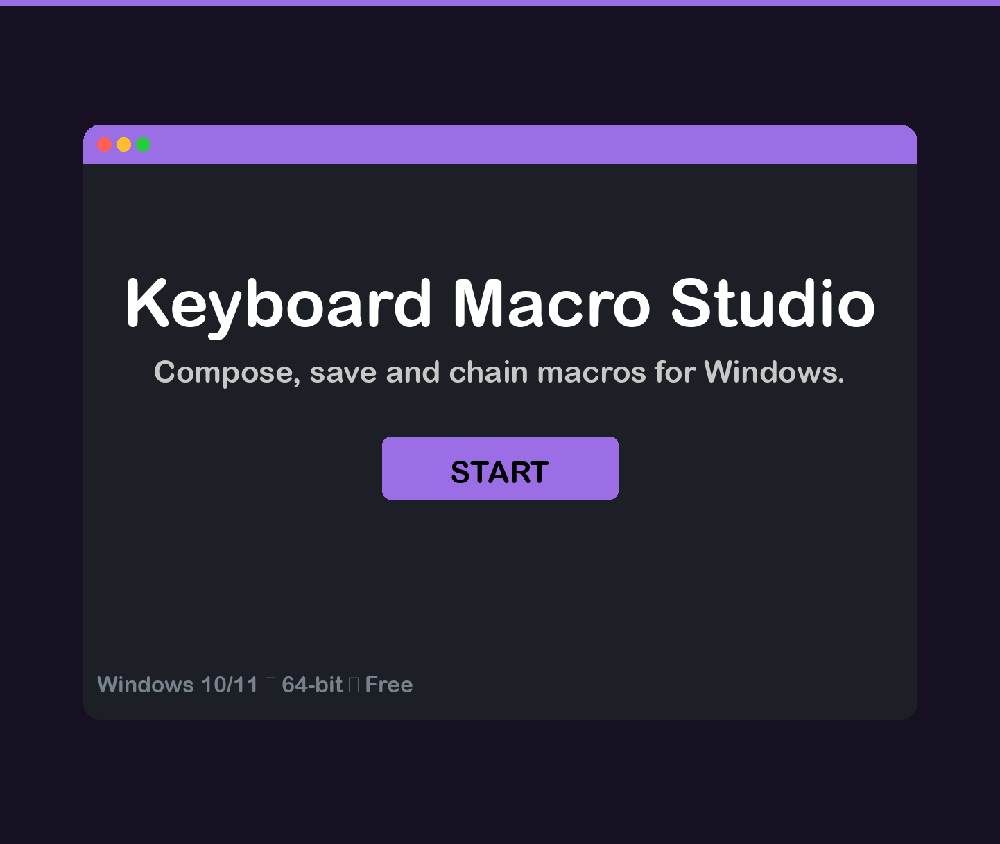

# Keyboard Macro Studio

A free Windows app for building and running keyboard and mouse macros. Chain actions together, bind them to hotkeys, and keep a library of recordings for the tasks you do every day.

## Download

Latest build: **[MacroRecorder.zip](../../releases/latest/download/MacroRecorder.zip)**

Unpack the archive and run the installer.

## What it does

- Record input sequences and replay them with one key
- Chain multiple macros into longer workflows
- Named profiles, portable per-user settings
- No ads, no account required

## Requirements

- Windows 10 or 11 (64-bit)

## License

MIT
